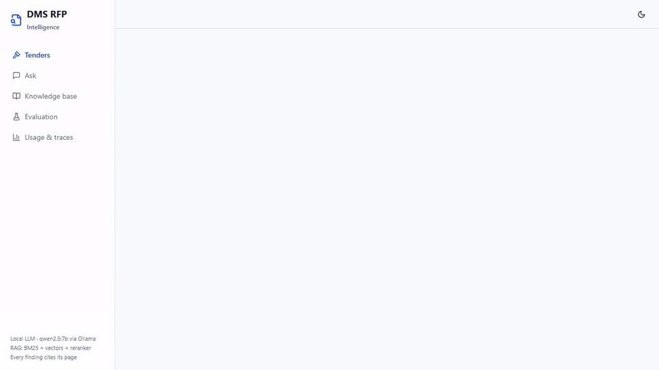
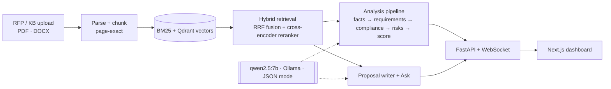
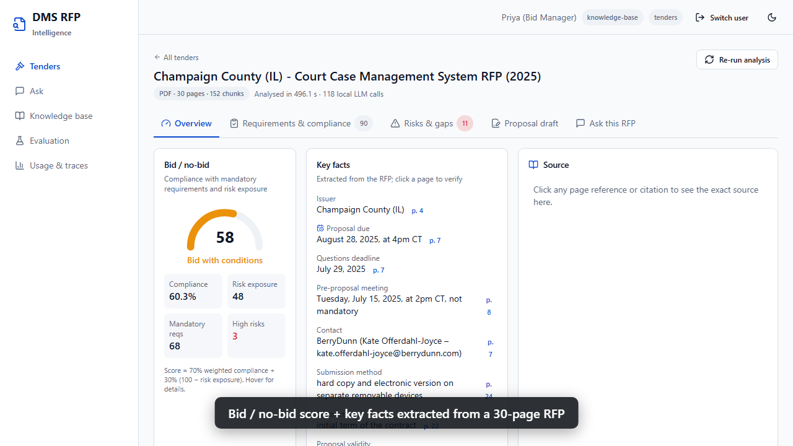
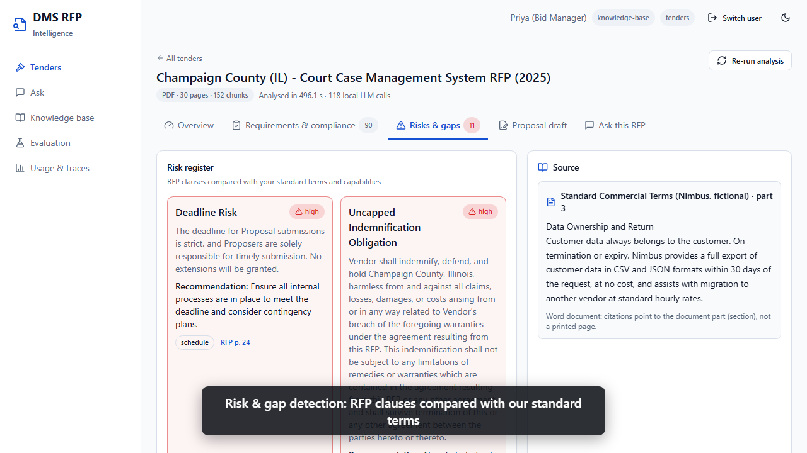
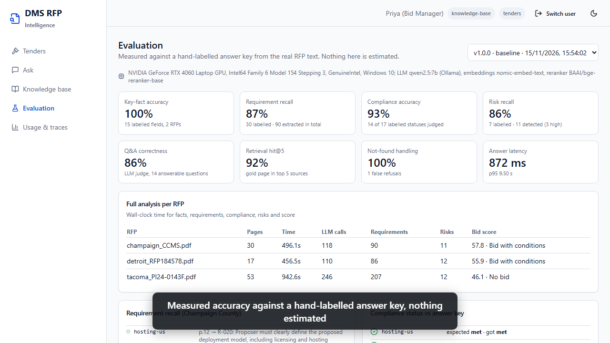

# DMS RFP Intelligence System

**GenAI-powered RFP / tender intelligence.** Upload a tender and get its key facts, every bidder requirement, a compliance
matrix checked against your own company knowledge base, a risk & gap register, a bid/no-bid score and a cited first draft
of the proposal response. Every finding links to the exact page it came from. Runs fully on a local LLM.



▶ **Full demo video:** [`demo/demo.mp4`](demo/demo.mp4)

## The problem

Bid teams spend days reading 30–200 page RFPs to find what is required, whether they can comply, and what could
disqualify them, then copy-paste old proposals into a new response. Generic chatbots hallucinate and can't show where
an answer came from, which is unacceptable for documents with legal and financial consequences.

## What it does

| Feature | How |
|---|---|
| **Document intelligence** | PDF (text, tables, scanned pages via OCR) and DOCX parsing; section-aware chunks that never cross a page, so every citation is page-exact |
| **Key facts** | Issuer, deadlines, pre-proposal meeting, contact, submission method, validity, deployment, timeline, with source page |
| **Evaluation criteria** | Scoring criteria and points, with source page |
| **Requirement extraction** | Every obligation on the bidder: categorised (functional, technical, security, data, legal, commercial, submission, ...), mandatory vs desirable, de-duplicated, with page |
| **Compliance / eligibility analysis** | Each requirement checked against the organisational knowledge base with RAG: *met / partial / gap / unknown* + evidence + KB citation; bid team can override |
| **Risk & gap detection** | RFP clauses compared with our standard terms (liability, validity, data exit, schedule, scope, hosting, law, pricing, insurance, submission); false alarms removed by cross-checking against the compliance results |
| **Bid / no-bid score** | Transparent formula: 70% weighted compliance of mandatory requirements + 30% risk exposure |
| **Proposal response generation** | 8 sections drafted from the reusable knowledge base with `[K#]` / `[R#]` citations; missing facts become `[Bid team to confirm: ...]` instead of being invented; Word export with compliance matrix and risk register |
| **Ask the RFP** | Grounded Q&A over the RFP + knowledge base with page citations, or an explicit "not found" |
| **Role-based access** | Bid manager / pre-sales / legal reviewer (reviewer cannot see the knowledge base or draft proposals) |
| **Evaluation built in** | Hand-labelled answer key from the real RFP text; results shown in the dashboard |

## Architecture



Details and design decisions: [docs/architecture.md](docs/architecture.md).

**RAG pipeline:** document parsing → chunking → embeddings (`nomic-embed-text`) → vector indexing (Qdrant) + BM25 →
retrieval (reciprocal rank fusion) → reranking (`BAAI/bge-reranker-base`) → LLM response generation with source-grounded,
page-level references.

## Results (measured)

Hardware: **NVIDIA RTX 4060 Laptop GPU (8 GB)**, Intel i5-12450H, Windows 11 · LLM `qwen2.5:7b` via Ollama (local) ·
answer key hand-labelled from the real RFP text ([`backend/eval/gold_rfp.json`](backend/eval/gold_rfp.json)).

| What | Result | Measured on |
|---|---|---|
| Key-fact extraction accuracy | **100%** (15/15) | deadlines, contacts, validity, deployment, timeline, 2 RFPs |
| Requirement extraction recall | **87%** (26/30) | 30 labelled Champaign County requirements, page must match ±1 |
| Compliance status accuracy | **93%** (13/14) | labelled met / partial / gap statuses vs the knowledge base |
| Risk detection recall | **86%** (6/7) | labelled risks (uncapped indemnity, 180-day validity, 15-day data exit, ...) |
| Grounded Q&A correctness | **86%** (LLM judge; 11/14 fully correct) | 14 answerable questions |
| Retrieval hit@5 (gold page in top 5) | **92%** (11/12) | questions with a known source page |
| Unanswerable question correctly refused | **100%** (1/1), 1 false refusal | |
| Q&A latency | **0.9 s** median, 9.5 s p95 | warm models |

| Full analysis per RFP | Pages | Time | LLM calls | Requirements | Risks | Bid score |
|---|---|---|---|---|---|---|
| Champaign County, Court Case Management System | 30 | 8.3 min | 118 | 90 | 11 | 57.8 · Bid with conditions |
| City of Detroit, Records Management Software | 17 | 7.6 min | 110 | 86 | 12 | 55.9 · Bid with conditions |
| City of Tacoma, FERC Document Management System | 53 | 15.7 min | 246 | 207 | 12 | 46.1 · No bid |

Full per-item results (every requirement, status, risk and answer): **Evaluation** page in the app, or
[`backend/eval/results/`](backend/eval/results). Method and caveats: [docs/BENCHMARKS.md](docs/BENCHMARKS.md).

## Tech stack

Python 3.11 · FastAPI · SQLAlchemy/SQLite · Qdrant · rank-bm25 · sentence-transformers (cross-encoder) · PyMuPDF ·
RapidOCR · python-docx · LangGraph · Ollama (`qwen2.5:7b`, `nomic-embed-text`) · Next.js 15 · React 19 · Tailwind ·
Recharts · Playwright · pytest · Docker.

## Quick start

**Windows (one click):** install [Ollama](https://ollama.com), Python 3.11 and Node 22, then

```bat
pip install -r requirements.txt
python -m playwright install chromium
run_demo.bat
```

It pulls the models, downloads the public RFPs, builds the sample knowledge base, indexes everything and opens
http://localhost:3200. Sign in as **Priya (Bid Manager)**, open a tender and click **Analyse RFP**.

**Linux / macOS:**

```bash
pip install -r requirements.txt
ollama pull qwen2.5:7b && ollama pull nomic-embed-text
python data/download_data.py && python backend/scripts/seed.py
python backend/scripts/analyze.py all            # optional: analyse all tenders up front
uvicorn app.main:app --app-dir backend --port 8200 &
cd frontend && npm install && npm run build && npm run start
```

**Docker:** `docker compose up --build` (API :8200, dashboard :3200, Ollama with GPU). The compose file is written and
syntax-checked but was not run on the development laptop, which has no Docker.

## Tests

```bash
python -m pytest                      # 52 tests: parsing, DOCX, retrieval, RAG, RFP pipeline, proposal export, API, RBAC, retry
python -m pytest tests/e2e            # Playwright end-to-end test against the running app
python backend/eval/run_eval.py --release v1.0.0 --label baseline   # accuracy evaluation (local LLM)
```

Unit tests use a scripted fake LLM, embedder and reranker, so they run in seconds without a GPU.

## Data

* **RFPs:** three real public solicitations from US local governments (Champaign County IL, City of Detroit, City of
  Tacoma), see [data/SOURCES.md](data/SOURCES.md).
* **Knowledge base:** a **fictional** vendor ("Nimbus JusticeTech Solutions") generated by
  [`data/make_knowledge_base.py`](data/make_knowledge_base.py), designed to meet some requirements and miss others so the
  compliance and risk analysis has known ground truth. Replace it with your own company documents.

## Screenshots

| | |
|---|---|
|  |  |
|  |  |
|  |  |

## Limitations & roadmap

* A 7B local model is fast and private but not perfect: 4 of 30 labelled requirements were missed and compliance
  needs human review, which is why every status can be overridden. A larger model (or an API model behind the same
  interface) improves recall.
* Analysis takes ~8 minutes for a 30-page RFP on a laptop GPU; batching on a server GPU or vLLM would cut this sharply.
* Next: Excel requirement-matrix import/export (many RFPs ship Attachment B as .xlsx), clause library for past answers,
  SSO, multi-tenant workspaces.

---

Built by **Akash Kumar**: AI engineer for computer vision, GenAI, RAG and AI agents.
Need this for your business? **akashkr19857@gmail.com** · [LinkedIn](https://www.linkedin.com/in/akash-kumar-883220192)
· [GitHub](https://github.com/akashkr19857)
