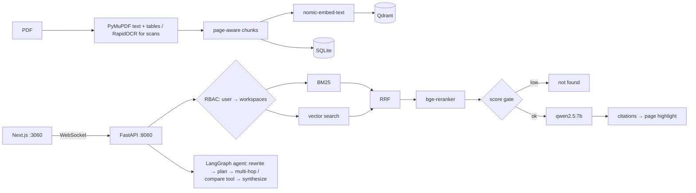

# DocBrain — Enterprise RAG with Evaluation

**Ask your company's PDFs in plain English and get answers with page-level citations, an honest "not found" when the
documents don't say, per-workspace access control, and quality measured on every release. Runs 100% locally.**


▶ Full demo video: [`demo/demo.mp4`](demo/demo.mp4)

## The problem
Companies keep their knowledge in thousands of PDFs: policies, frameworks, contracts, reports. Finding one answer
means opening many files, and generic LLM chatbots answer confidently even when they are wrong. Teams need answers
they can verify in seconds, that respect who may see which document, and a number that says how often the system is right.

## Features
- **Ingestion of real-world PDFs**: text with layout boxes, ruled tables → Markdown, **scanned pages → OCR**
  (RapidOCR / PP-OCR, column-aware reading order). Chunks keep page + section metadata and never cross a page.
- **Hybrid retrieval**: BM25 + dense vectors (`nomic-embed-text`, Qdrant embedded) fused with Reciprocal Rank Fusion,
  then a **cross-encoder reranker** (`BAAI/bge-reranker-base`).
- **Grounded answers** from local `qwen2.5:7b` (Ollama), streamed over WebSocket, with **clickable citations that open
  the PDF page with the cited passage highlighted**.
- **"Not found in your documents" path**: a reranker-score gate (no LLM call) plus an LLM refusal rule.
- **Agent mode (LangGraph)**: query rewriting → planning → multi-hop sub-question loop or a
  **compare-two-documents tool** → cited synthesis; every step and its timing is shown in the UI.
- **Role-based access**: documents live in workspaces; the workspace filter is applied inside the Qdrant and BM25
  queries, so a user can never retrieve another workspace's text.
- **Evaluation**: 45-question hand-written gold set, retrieval hit@k ablation, answer correctness, faithfulness /
  hallucination rate, context recall, not-found accuracy, latency p50/p95 — stored as a history per release.
- **Observability**: every query is traced (latency per stage, tokens, retrieved chunks with BM25/vector/rerank
  ranks, agent steps), with a live usage page.
- **Dashboard** (Next.js + Tailwind + Recharts): Chat, Documents (upload with live ingest progress, page preview),
  Evaluation, Usage & traces; dark/light, responsive.

## Architecture

Details and design decisions: [docs/architecture.md](docs/architecture.md).

## Results (measured)
Hardware: **NVIDIA RTX 4060 Laptop (8 GB), Intel i5-12450H, Windows 11**; all models local (qwen2.5:7b Q4 via
Ollama, nomic-embed-text, bge-reranker-base fp16). Corpus: 4 public NIST PDFs, 153 pages incl. a 9-page scanned PDF.
Gold set: 45 questions (factual, table, OCR, multi-hop, compare, unanswerable, access-control).

| Release | Pipeline | Hit@5 | Correctness | Faithfulness | Hallucination rate | Not-found accuracy | Latency p50 | Latency p95 |
| --- | --- | --- | --- | --- | --- | --- | --- | --- |
| v0.1.0 | vector only | 80.0% | 70.0% | 98.3% | 5.7% | 100.0% | 3.8 s | 19.8 s |
| v0.2.0 | hybrid+rerank | 92.5% | 82.5% | 97.4% | 7.7% | 80.0% | 4.8 s | 7.3 s |
| v0.3.0 | agent | 90.0% | 81.2% | 99.1% | 2.6% | 100.0% | 6.2 s | 11.6 s |

Retrieval ablation (gold page in top-5, 40 answerable questions, no LLM):

| Retriever | Hit@1 | Hit@3 | Hit@5 | MRR | Retrieval latency p50 |
|---|---|---|---|---|---|
| bm25 | 50.0% | 80.0% | 82.5% | 0.631 | 2 ms |
| vector | 57.5% | 77.5% | 80.0% | 0.667 | 43 ms |
| hybrid | 60.0% | 80.0% | 85.0% | 0.702 | 42 ms |
| hybrid+rerank | 67.5% | 85.0% | 92.5% | 0.777 | 323 ms |

Honest notes:
- The judge is the same local qwen2.5:7b (temperature 0); use the scores to compare releases, not as absolute truth.
- Latency was measured while other projects shared this laptop's GPU/CPU (and the eval waited on a shared GPU lock per question).
- Known misses in the hybrid release: one subcategory mix-up (RC.CO-03 given for RC.RP-03), a table question the
  model refused, and the access-control question where the user without access got a hedged non-answer instead of
  the exact "not found" message (no text from the other workspace was retrieved).

Full tables, metric definitions, per-category scores, edge and ingestion numbers: **[docs/BENCHMARKS.md](docs/BENCHMARKS.md)**.

## Tech stack
Python 3.11 · FastAPI · WebSocket · LangGraph · Ollama (qwen2.5:7b, nomic-embed-text) · Qdrant (embedded) · rank-bm25 ·
sentence-transformers cross-encoder · PyMuPDF · RapidOCR (PP-OCR ONNX) · SQLAlchemy + SQLite · ONNX Runtime ·
Next.js 15 · React 19 · Tailwind · shadcn/ui-style components · Recharts · pytest · Playwright.

## Quick start
### Windows (one click)
Prerequisites: [Ollama](https://ollama.com) running, Python 3.11 with `pip install -r requirements.txt`
(or the shared venv), Node 22.
```bat
run_demo.bat
```
It pulls the models if missing, downloads the public PDFs, builds the index on first run (a few minutes, OCR is
CPU-bound), starts the API on http://localhost:8060 and the dashboard on http://localhost:3060.
Pick a demo user: **alice** (ai-governance), **bob** (cybersecurity) or **admin** (both). Demo sign-in has no
passwords; production would plug SSO/OIDC into `backend/app/main.py: current_user`.

### Linux / macOS
```bash
ollama pull qwen2.5:7b && ollama pull nomic-embed-text
pip install -r requirements.txt
python data/download_data.py && python backend/scripts/seed.py
(cd backend && uvicorn app.main:app --port 8060) &
cd frontend && npm install && npm run build && npm run start
```

### Docker
`docker compose up --build` (Ollama + API + dashboard). The compose file and Dockerfiles are written and
syntax-checked but **were not run**: Docker is not installed on the development machine.

### Re-run the evaluation
```bash
python backend/eval/run_eval.py --release v0.2.0 --label "hybrid+rerank"
python backend/eval/make_benchmarks.py
```

## Edge deployment
`edge/export_reranker_onnx.py` exports the reranker to ONNX, makes an int8 copy, checks score agreement and
benchmarks it. Set `DOCBRAIN_RERANK_PROVIDER=onnx` to serve with the ONNX model. Measured for reranking 20 candidates:

| Runtime | p50 | p95 | Max logit diff vs PyTorch fp32 | Same top-1 |
|---|---|---|---|---|
| pytorch_cpu_fp32 | 4297.9 ms | 4938.6 ms | 0.0 | True |
| onnxruntime_cpu_fp32 | 3286.9 ms | 3891.8 ms | 0.0 | True |
| onnxruntime_cpu_int8 | 2216.2 ms | 2330.9 ms | 1.0006 | True |
| pytorch_cuda_fp16 | 23.0 ms | 24.3 ms | 0.0081 | True |

A Jetson Orin guide and `edge/Dockerfile.jetson` are included in [edge/JETSON.md](edge/JETSON.md) — **not tested on a
physical Jetson**.

## Tests
```bash
python -m pytest                      # unit + API tests, no GPU/Ollama needed (fake LLM, embedder, reranker)
python -m pytest tests/e2e -p no:cacheprovider   # Playwright E2E against the running app
```
Current status: **__PYTEST__**, **__E2E__**.

## Screenshots
| | |
|---|---|
|  |  |
|  |  |
|  |  |

## Data
Public-domain NIST publications (AI RMF 1.0, Generative AI Profile, CSF 2.0, a scanned copy of the CSF 2.0 Small
Business Quick-Start Guide). Sources and licence: [data/SOURCES.md](data/SOURCES.md).

## Roadmap
- SSO/OIDC and document-level permissions inside a workspace
- Incremental re-indexing and de-duplication across document versions
- Separate, stronger judge model for evaluation; RAGAS integration
- OCR on GPU and table structure recognition for borderless tables
- Answer caching and a smaller model profile for CPU-only deployments

---
Built by **Akash Kumar** · MIT licence

**Need this for your business? Contact Akash Kumar: akashkr19857@gmail.com · linkedin.com/in/akash-kumar-883220192**
