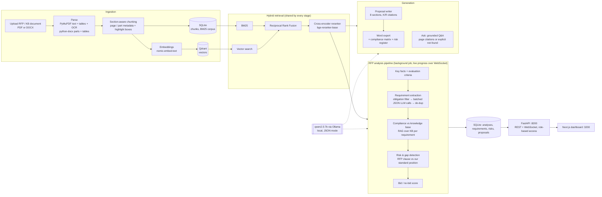

# Architecture

## Why it is built this way

| Decision | Reason |
|---|---|
| Hybrid BM25 + vectors + reranker | RFPs are full of exact terms (section numbers, "180 calendar days", system names) that pure vector search misses; BM25 catches them, the reranker orders the fused list. |
| Chunks never cross a page | Every requirement, fact, risk and answer can cite one exact page and highlight the passage. |
| Obligation-language pre-filter | Only chunks with "shall / must / required / ..." go to requirement extraction, cutting LLM calls on background pages (statistics, definitions). |
| JSON-mode LLM calls with source numbers | Each LLM output names the excerpt it used; the code maps it back to page + chunk, so citations are produced by the system, not trusted from free text. |
| Compliance = RAG over the knowledge base | Each requirement retrieves its own evidence from company documents, so the status is explainable ("met because ... [Security policy, part 3]"). |
| Risks compare both sides | The risk prompt sees the RFP clause and our standard position side by side, so it reports conflicts (e.g. 15-day vs 30-day data return) rather than generic clauses. |
| Deterministic bid score | The score is a transparent formula over compliance and risk severity, not an LLM opinion. |
| Missing facts become placeholders | The proposal writer must write "[Bid team to confirm: ...]" instead of inventing numbers. |
| Local LLM (Ollama) | Tender documents are confidential; nothing leaves the machine and there is no per-token cost. |

## Data model

`documents` (workspace = tenders | knowledge-base) → `chunks` · per tender: `analyses` (facts, criteria, timings, bid score),
`requirements` (status, evidence, KB sources, manual override), `risks`, `proposals` (sections + citations, DOCX path) ·
`traces` (every Q&A query) · `eval_runs`.

## Roles (demo)

| User | Tenders | Knowledge base | Notes |
|---|---|---|---|
| Bid Manager (admin) | ✓ | ✓ | sees all traces |
| Pre-sales Engineer | ✓ | ✓ | |
| Legal Reviewer | ✓ | ✗ | can review risks; cannot draft proposals (no KB access) |
